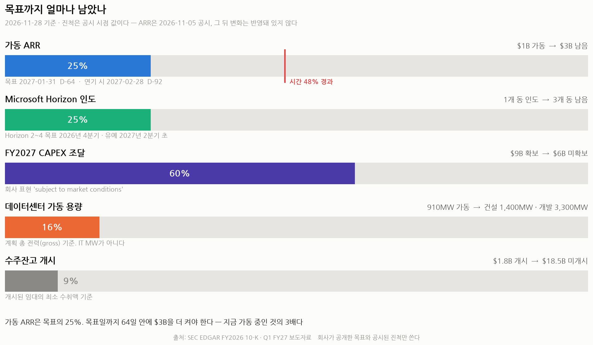
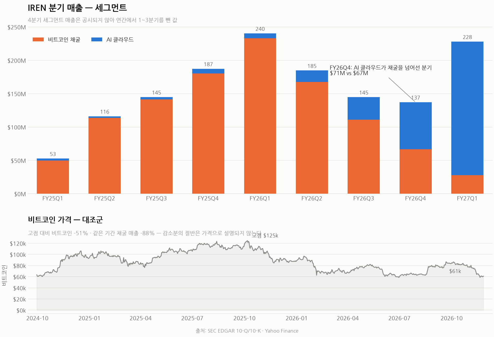
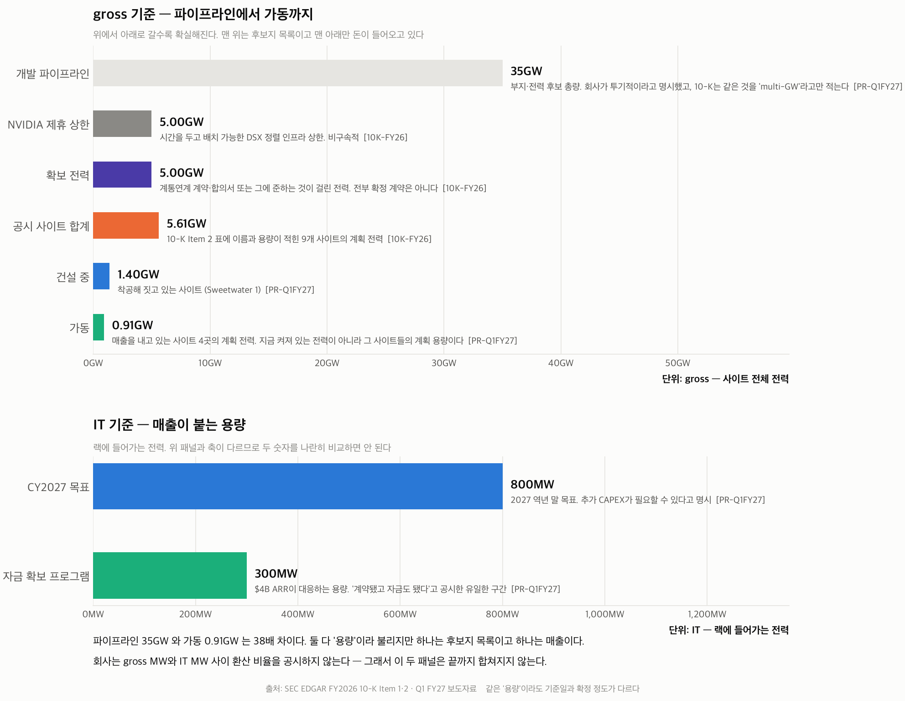
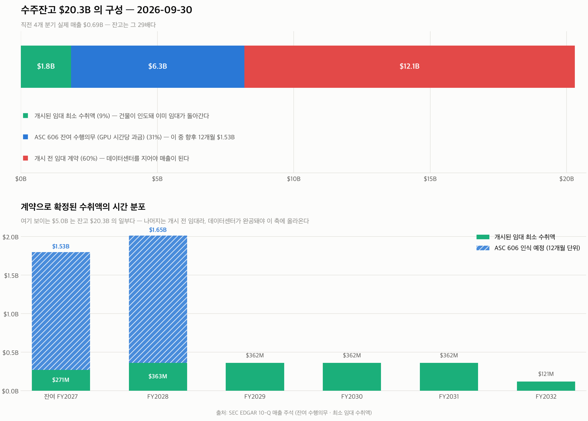
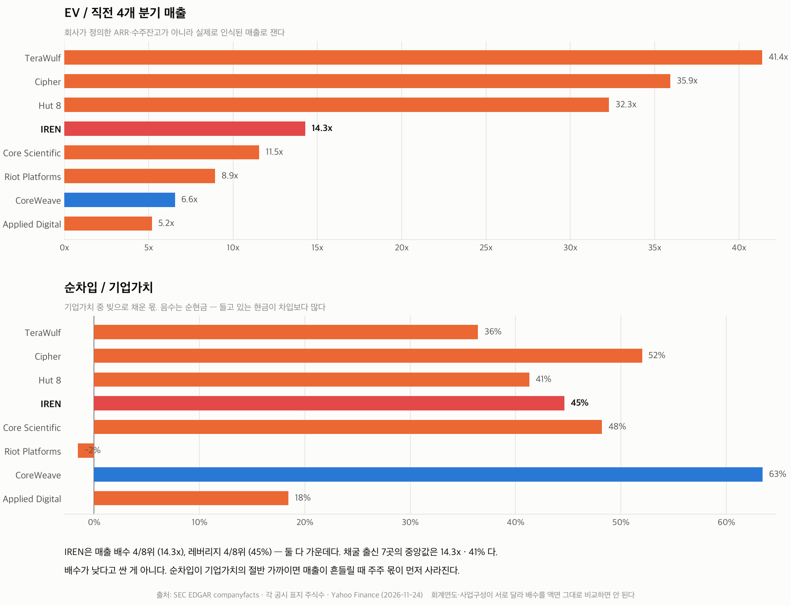
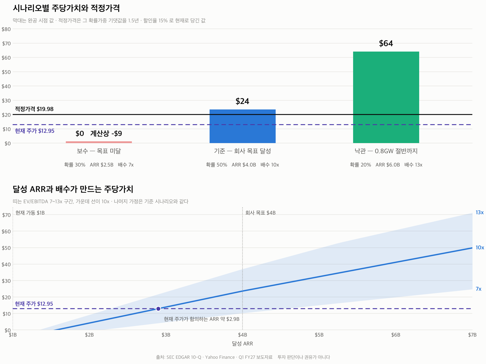

# IREN Revenue Structure

**대시보드 → https://gwonyongjin94-ui.github.io/IREN-Revenue-structure/**

IREN(구 Iris Energy, NASDAQ: IREN)의 매출 구조와 적정가격을 공시된 숫자로만
뜯어보는 프로젝트.

이 회사는 2026년 두 분기 만에 다른 회사가 됐다. 매출을 결정하는 공식 자체가
바뀌었다.

```
예전   채굴 매출     = 해시레이트 x 해시프라이스        (비트코인 가격에 연동)
지금   AI 클라우드   = 가동 MW(IT) x MW당 연매출        (계약 단가에 연동)
```

FY2026Q1(2025년 9월 분기)에 매출 $240M 중 97%가 채굴이었다. 네 분기 뒤인
FY2027Q1(2026년 9월 분기)에는 매출 $228M 중 88%가 AI 클라우드다. 총액은
비슷한데 안에 든 것이 완전히 다르다.

그래서 이 저장소는 세 가지를 추적한다.

- **매출 구성** — 무엇이 사라졌고 무엇이 들어왔는가
- **데이터센터** — 9개 사이트 5.6GW 중 실제로 돌아가는 건 어디인가
- **수주잔고** — 계약된 $20.3B 중 실제로 돌아가는 돈은 얼마인가
- **자금** — 남은 CAPEX $15B 을 어떻게 메우는가. 이게 적정가격을 지배한다

모든 수치는 SEC EDGAR 공시와 공개 시세에서 자동으로 가져온다. 사람이 손으로
적는 값은 [`disclosures.py`](disclosures.py) 한 파일에 모았고, 항목마다 출처를
달았다.

오늘 숫자만 보고 싶으면 [SNAPSHOT.md](SNAPSHOT.md).

---

## 지금 어디까지 왔나

```bash
./.venv/bin/python progress.py
```



IREN은 목표를 꽤 구체적으로 공개한다. 문제는 보도자료가 목표와 현재를 다른
문단에 떼어 놓는다는 것이다. 둘을 나란히 두면 이렇다.

| 목표 | 공개한 목표치 | 공시된 진척 | 달성률 | 시한 |
|---|---:|---:|---:|---|
| 가동 ARR | $4B | $1B | **25%** | 2027-01-31 (2월 말까지 연기 가능) |
| Microsoft Horizon 인도 | 4개 동 | 1개 동 | **25%** | 2~4동 2026년 4분기, 유예 2027년 2분기 초 |
| FY2027 CAPEX 조달 | $15B | $9B 확보 | **60%** | "subject to market conditions" |
| 데이터센터 가동 용량 | 5,610MW 계획 | 910MW 가동 | **16%** | 사이트별 시한 없음 |
| 수주잔고 개시 | $20.3B | $1.8B 개시 | **9%** | 건설 일정에 연동 |

ARR 막대에는 **시간 경과율**을 같이 찍어 뒀다. 직전 공시 분기말(2026-09-30)
부터 목표일까지 123일인데, 그중 절반 가까이가 지났다. 진척 25%와 경과 46%를
겹쳐 보면 남은 기간에 필요한 속도가 바로 읽힌다 — **목표일까지 지금 가동
중인 것의 3배를 더 켜야 한다.**

두 가지는 분명히 해 둔다.

- **진척은 공시 시점 값이다.** ARR과 Horizon 인도는 분기마다, 또는 사건이
  있을 때만 공시된다. 오늘 실제 값은 이보다 앞서 있을 수 있고, 그 간격을
  추정치로 메우지 않는다
- **달성률의 분모가 목표마다 다르다.** ARR은 회사가 제시한 목표치, 용량은
  공시된 계획 총 전력, 잔고는 계약 총액이다. 세로로 더하거나 평균 내서
  "전체 몇 %"라고 읽으면 안 된다

---

## 1. 매출 구성의 교체

```bash
./.venv/bin/python segments.py
```



| 회계연도 | 총매출 | 비트코인 채굴 | AI 클라우드 |
|---|---:|---:|---:|
| FY2024 | $187M | $184M | $3M |
| FY2025 | $501M | $485M | $16M |
| FY2026 | $707M | $578M | $129M |
| FY2027Q1 | $228M | $28M | $200M |

채굴 매출은 FY2026Q1 $233M 에서 FY2027Q1 $28M 으로 **−88%** 다. 같은 기간
비트코인은 고점 $125k 에서 $59k 로 **−53%** 다. 가격만으로는 절반밖에 설명이
안 된다. 나머지는 회사가 스스로 접은 몫이다. FY2026 10-K는 자산손상 $638.8M을
인식했고 대부분이 채굴기 폐기다.

회사는 Q1 FY27 보도자료에 채굴 종료 시점을 적지 않았다. 적힌 것은 손상
처리와 매출 감소뿐이다. (언론은 2026년 말 완전 철수를 보도했지만, 공시에
없는 내용이라 이 저장소의 모델에는 넣지 않는다.)

### AI 클라우드 안쪽은 또 둘로 갈린다

FY2027Q1 AI 클라우드 매출 $200M 의 구성이다.

| 항목 | 금액 | 회계기준 | 성격 |
|---|---:|---|---|
| AI Cloud Services | $135M | ASC 606 | GPU 시간당 과금. IREN이 GPU를 보유 |
| AI Cloud Lease | $65M | ASC 842 | 코로케이션 임대. 고정 $49M + 변동 $16M |

둘을 나눠 봐야 하는 이유는 **수주잔고를 세는 방법이 다르기 때문**이다. ASC
606 쪽은 '잔여 수행의무'로, ASC 842 쪽은 '계약 임대 총액'으로 공시된다.
회사가 보도자료에 쓰는 backlog는 성격이 다른 이 둘을 더한 값이다.

---

## 2. 데이터센터는 어디에 있나

```bash
./.venv/bin/python sites.py
```


FY2026 10-K Item 2에 사이트 9곳이 용량과 함께 표로 나온다. 지도에 단계별로
색을 입히면 "5GW 확보"라는 말이 실제로 무슨 상태인지가 갈린다.

### 사이트 전체

| 사이트 | 위치 | 계획 용량 (gross) | 단계 | 상태 |
|---|---|---:|---|---|
| Kiowa | 오클라호마, 미국 | 1,600MW | 개발 | 최대 부지. 부지·전력만 확보 |
| Sweetwater 1 | 텍사스, 미국 | 1,400MW | **건설** | 액랭식 건설 진행 |
| Childress | 텍사스, 미국 | 750MW | **가동** | Horizon 1 인도 완료, 2~4 건설 후반 |
| Bundey | 남호주, 호주 | 800MW | 개발 | 2028년 전력 투입 목표 |
| Sweetwater 2 | 텍사스, 미국 | 600MW | 개발 | 초기 |
| Badajoz | 엑스트레마두라, 스페인 | 300MW | 개발 | 토목 인허가 |
| Mackenzie | BC, 캐나다 | 80MW | **가동** | 공랭 개조 + 액랭 신규 착공 |
| Prince George | BC, 캐나다 | 50MW | **가동** | AI 클라우드 GPU 가동 |
| Canal Flats | BC, 캐나다 | 30MW | **가동** | 최초 사이트. BC Hydro 수력 |
| **합계** | 9곳 · 4개국 | **5,610MW** | | |

단계별로 묶으면 이렇다.

| 단계 | 사이트 | 계획 용량 | 비중 |
|---|---|---:|---:|
| **가동** | Canal Flats · Prince George · Mackenzie · Childress | **910MW** | 16% |
| **건설** | Sweetwater 1 | **1,400MW** | 25% |
| **개발** | Sweetwater 2 · Kiowa · Bundey · Badajoz | **3,300MW** | 59% |

지역은 넷으로 갈린다.

- **브리티시컬럼비아 (캐나다) 160MW** — Canal Flats(30), Prince George(50),
  Mackenzie(80). 가장 오래된 사이트들이고 전부 가동 중이다. BC Hydro 수력에
  연결돼 있어 전력의 98%가 청정에너지다. Prince George가 AI 클라우드 GPU를
  돌리는 곳이고, Mackenzie는 공랭식 개조와 액랭식 신규 건설이 같이 돈다
- **텍사스 · 오클라호마 (미국) 4,350MW** — 무게중심이 여기다. Childress(750)에
  Microsoft 계약($9.7B)의 Horizon 1~4가 들어간다. Horizon 1은 2026년 8월
  인도·검수 완료, Horizon 2~4는 2026년 4분기 인도 목표다. Sweetwater 1(1,400)은
  액랭식 건설 중, Sweetwater 2(600)와 Kiowa(1,600)는 부지만 잡아 둔 상태다
- **스페인 300MW** — Badajoz. 토목 인허가를 받은 단계
- **남호주 800MW** — Bundey. 애들레이드 북동 약 125km. 2028년 전력 투입 목표라
  이번 밸류에이션 기간에는 매출이 없다

### '규모'라 불리는 여섯 개의 숫자

```bash
./.venv/bin/python scale.py
```



IREN 자료를 읽다 보면 용량이라는 이름으로 35GW, 5GW, 5.6GW, 1.4GW, 0.9GW,
0.8GW, 0.3GW가 번갈아 나온다. 백 배 넘게 차이 나는 숫자들이 전부 '용량'이다.
정의와 출처를 갈라 두면 이렇다.

| 숫자 | 기준 | 무슨 뜻인가 | 출처 |
|---:|---|---|---|
| **35GW** | gross | 개발 파이프라인. 회사가 투기적 총량이라고 명시. 같은 것을 10-K는 "multi-GW"라고만 적는다 | Q1 FY27 보도자료 |
| **5GW** | gross | NVIDIA 제휴로 시간을 두고 배치 가능한 상한. 비구속적 | FY2026 10-K |
| **5GW** | gross | 확보 전력. "계통연계 계약, 합의서 또는 그에 준하는 것"이 걸린 전력 — 전부 확정 계약은 아니다 | FY2026 10-K |
| **5,610MW** | gross | 10-K Item 2 표에 이름과 용량이 적힌 9개 사이트 | FY2026 10-K |
| **1,400MW** | gross | 착공해 짓고 있는 사이트 | Q1 FY27 보도자료 |
| **910MW** | gross | 매출을 내는 사이트 4곳의 **계획** 전력 (켜져 있는 전력이 아니다) | Q1 FY27 보도자료 |
| **800MW** | **IT** | CY2027 용량 목표. 추가 CAPEX 필요 | Q1 FY27 보도자료 |
| **300MW** | **IT** | $4B ARR이 대응하는, "계약·자금 모두 확보"라고 공시한 구간 | Q1 FY27 보도자료 |

파이프라인 35GW와 가동 910MW는 **38배** 차이다. 둘 다 '용량'이지만 하나는
후보지 목록이고 하나는 매출이다. 숫자만 옮겨 적으면 같은 회사가 "5GW 기업"
도 되고 "0.9GW 기업"도 된다.

### 이 지도에서 읽어야 할 것

**MW 단위가 두 종류다.** 위 5,610MW는 **gross MW** — 사이트 전체의 계획 전력
이고, 랙에 들어가는 **IT MW**가 아니다. 회사는 둘 사이 환산 비율을 공시하지
않는다.
$4B ARR이 대응하는 0.3GW와 CY2027 목표 0.8GW는 **IT 기준**이므로, "5.6GW나
확보했는데 목표가 0.3GW뿐"이라고 읽으면 틀린다.

**그래도 비중은 말이 된다.** 매출을 내는 사이트가 계획 용량의 16%뿐이고,
59%는 아직 삽을 뜨지 않았다. [5절](#5-자금--실제-제약은-여기다)의 미확보
$6B 이 어디에 쓰일 돈인지가 이 지도에 그대로 보인다 — Sweetwater 2, Kiowa,
Bundey, Badajoz를 짓는 돈이다. 그 돈이 안 구해지면 저 3,300MW는 땅으로 남는다.

### "채굴장을 데이터센터로 바꾼다"는 이야기는 어디까지 맞나

IREN이 주목받은 논리는 대개 이렇게 요약된다 — *채굴로 이미 전력과 부지를
쥐고 있으니, 그걸 AI 데이터센터로 돌리면 남들보다 빠르고 싸게 지을 수 있다.*
절반은 맞고 절반은 틀리다. 이 저장소의 숫자로 갈라 보면 이렇다.

**맞는 쪽 — 병목은 건물이 아니라 전력이다.** AI 데이터센터에서 가장 오래
걸리는 건 계통연계다. 신규로 수 GW 전력을 잡으려면 접속 대기열에서 몇 년이
걸린다. 채굴 회사들은 그 전력과 부지, 변전 설비, 그리고 대규모 전력 사이트를
짓고 돌려 본 경험을 이미 갖고 있었다. IREN의 확보 전력 5.6GW가 그 유산이고,
Childress와 Mackenzie에서 실제로 공랭식 개조가 진행 중이다. 출발선이 앞선
것은 사실이다.

**틀린 쪽 — 건물은 거의 재활용되지 않는다.** 채굴장은 랙당 5~10kW 공랭에
이중화도 없는 헛간에 가깝다. AI 학습은 랙당 수십~130kW 액랭에 이중화가
필요하다. 사실상 다시 짓는다. 공시에 그 흔적이 세 군데 남아 있다.

| 증거 | 숫자 | 뜻 |
|---|---:|---|
| FY2026 자산손상 | **$638.8M** | 대부분 채굴기 폐기. 장비는 승계되지 않았다 |
| 자본집약도 | **MW(IT)당 약 $50M** | $15B ÷ 0.3GW(IT). 전환이 쌌다면 이 숫자가 이렇게 클 수 없다 |
| 채굴 유산 비중 | **16%** | 채굴 시절 사이트 910MW / 전체 5,610MW. 나머지 84%는 AI를 위해 새로 잡은 부지다 |

셋째 줄이 가장 직접적이다. Sweetwater 1·2(2,000MW), Kiowa(1,600MW),
Bundey(800MW), Badajoz(300MW) — 파이프라인의 **84%가 채굴과 무관한 신규
부지**다. 즉 지금의 IREN은 "채굴장을 개조한 회사"라기보다 **채굴로 번 돈과
전력 확보 역량으로 데이터센터를 새로 짓는 회사**에 가깝다.

그래서 투자 논리도 바뀐다. "전환이 싸다"가 아니라 "전력을 잡는 데 능하고,
그걸 지을 돈을 구할 수 있느냐"가 된다. 그리고 돈 쪽은 아직 $6B이 열려 있다.
[6절의 경쟁사 비교](#6-경쟁사-비교)도 같은 말을 한다 — 채굴 출신 7곳이
전부 같은 전환을 하고 있는데 매출 배수가 5.2x에서 41.4x까지 흩어져 있다.
'채굴 출신'이라는 꼬리표 자체는 프리미엄을 주지 않는다.

## 3. 수주잔고 $20.3B 을 쪼개면

```bash
./.venv/bin/python backlog.py
```



10-Q 매출 주석에서 두 다리를 따로 읽을 수 있다.

| | 금액 | 비중 |
|---|---:|---:|
| ASC 606 잔여 수행의무 | $6.35B | 31% |
| ASC 842 계약 임대 — 그중 **이미 개시된** 임대의 최소 수취액 | $1.84B | 9% |
| ASC 842 계약 임대 — **아직 개시되지 않은** 계약 | $12.12B | 60% |
| **합계** | **$20.30B** | |

핵심은 셋째 줄이다. 임대 계약 $13.96B 중 **87%가 아직 개시되지 않았다**.
개시되지 않았다는 건 건물이 없다는 뜻이고, 건물을 지으려면 CAPEX가 든다.

즉 수주잔고는 매출 약속인 동시에 **지출 약속**이다. "backlog $20.3B 인데
시가총액이 $5.5B"라는 비교가 성립하지 않는 이유가 여기 있다. 그 $20.3B 을
매출로 바꾸려면 $15B 을 더 써야 하고, 그 돈의 출처가 아직 다 정해지지 않았다.

계약으로 확정돼 시간표까지 나와 있는 돈은 이 정도다.

- ASC 606 향후 12개월 **$1.53B**, 그다음 12개월 **$1.65B**
- 개시된 임대 최소 수취액 잔여 FY2027 **$271M**, FY2028~FY2031 매년 **$362M** 안팎

---

## 4. ARR = MW(IT) x MW당 단가

```bash
./.venv/bin/python arr_model.py
```


AI 데이터센터 매출의 분모는 랙에 들어가는 전력이다. 회사가 공시한 점이
세 개 있는데, **서로 맞지 않는다**.

| 공시 | 함의하는 MW당 연매출 |
|---|---:|
| 목표 ARR $4B ↔ 0.3GW(IT) | **$13.3M** |
| 분기 후 체결한 5년 계약 | **$22M** |
| 분기 후 체결한 단기 계약 | **$40M** |

목표가 함의하는 단가가 새로 맺은 5년 계약 단가의 60% 수준이다. 설명은 둘 중
하나다.

1. 0.3GW 에 단가가 낮은 코로케이션 전용 계약이 섞여 있다
2. 0.3GW 가 매출을 내는 MW가 아니라 설치 기준 총량이다

회사는 어느 쪽인지 밝히지 않았다. 이 차이는 작지 않다 — CY2027 목표인
0.8GW(IT)에 대입하면 ARR이 **$10.7B 에서 $17.6B 사이** 어디로든 간다. 그래서
이 저장소는 단일 추정선을 긋지 않고 단가 밴드로 그린다.

### 교차 검증

ARR은 회사가 정의한 지표(계약된 가동 GPU의 시간당 단가 x 8,760시간)라 외부에서
직접 검증할 수 없다. 대신 실제 분기 매출을 연율화해 방향만 맞춰 본다.

| | FY26Q3 | FY26Q4 | FY27Q1 |
|---|---:|---:|---:|
| AI 클라우드 분기 매출 x 4 | $0.13B | $0.28B | **$0.80B** |

공시된 가동 ARR 약 $1B 과 같은 자리수다. ARR은 분기말 가동 기준이고 분기
매출은 기간 평균이라, 램프업 중에 연율화 값이 ARR보다 낮게 나오는 건 정상이다.

---

## 5. 자금 — 실제 제약은 여기다

```bash
./.venv/bin/python funding.py
```


회사가 Q1 FY27 보도자료 각주에 적은 FY2027 자금 계획이다.

| | 금액 |
|---|---:|
| 2026-09-30 기준 남은 CAPEX | $15.0B |
| 확보 — 현금·제한현금 | $5.8B |
| 확보 — 약정 GPU 금융 + 고객 선급금 | $3.2B |
| **미확보 — "subject to market conditions"** | **$6.0B** |

Q1 FY27 영업활동 현금흐름은 $0.5B 이다. 영업으로 메울 수 있는 규모가 아니다.
저 $6.0B 은 증자 아니면 추가 차입으로 메워야 하고, 둘 다 주당가치를 깎는다.

### 차입 $10.0B 의 3분의 2가 전환사채다

| 구분 | 원금 | 비중 |
|---|---:|---:|
| 전환사채 | $6.75B | 67% |
| 비소구 (USPP, DDTL) | $1.98B | 20% |
| GPU 담보 금융 | $1.30B | 13% |

전환사채는 표면적으로 싸다 — 2031·2032·2033년물의 실효금리가 0.37~1.18%다.
대신 전환가에 옵션이 붙어 있다. 원금 $6.75B 을 희석 주식수 1억 2,720만 주로
나누면 **평균 전환가 약 $53** 이 나온다. 현재 주가 $12.95 의 **4.1배**다.

여기서 두 가지가 동시에 따라온다.

- **지금**: 주가가 전환가에서 멀어 전환 가능성이 낮다. 그냥 $6.75B 짜리 빚이다
- **나중**: 주가가 $53 근처까지 회복하면 1.27억 주가 새로 생긴다. 상방이 눌린다

밸류에이션에서 전환사채를 "희석 주식수"로만 세면 지금의 레버리지를 놓치고,
"부채"로만 세면 회복 구간의 희석을 놓친다. 그래서 [`valuation.py`](valuation.py)는
시나리오마다 주당가치가 평균 전환가를 넘는지 보고 둘을 전환해 가며 푼다.

### 만기

| | 잔여 FY27 | FY28 | FY29 | FY30 | FY31 | 이후 |
|---|---:|---:|---:|---:|---:|---:|
| 상환 예정 | $0.72B | $1.06B | $0.82B | $0.73B | $0.27B | $6.43B |

당장의 만기 벽은 없다. 압박은 만기가 아니라 **지금 써야 하는 CAPEX** 쪽에서 온다.

---

## 6. 경쟁사 비교

```bash
./.venv/bin/python peers.py
```



IREN만 보면 "수주잔고가 시가총액의 4배"처럼 들리는 숫자가 전부 싸 보인다.
같은 일을 하는 회사들과 같은 잣대로 재야 그게 업종 평균인지 이 회사만의
특징인지 갈린다. 비교는 **SEC 공시와 시세만으로 계산되는 두 가지**로만 한다 —
ARR이나 수주잔고는 회사마다 정의가 달라 비교가 성립하지 않는다.

| 회사 | 분류 | TTM 매출 | 시가총액 | 순차입 | EV/매출 | 순차입/EV |
|---|---|---:|---:|---:|---:|---:|
| TeraWulf | 채굴 출신 | $0.19B | $5.0B | $2.9B | 41.4x | 36% |
| Cipher | 채굴 출신 | $0.15B | $2.5B | $2.7B | 35.9x | 52% |
| Hut 8 | 채굴 출신 | $0.31B | $5.8B | $4.1B | 32.3x | 41% |
| **IREN** | 채굴 출신 | **$0.70B** | **$5.5B** | **$4.4B** | **14.3x** | **45%** |
| Core Scientific | 채굴 출신 | $0.59B | $3.5B | $3.3B | 11.5x | 48% |
| Riot Platforms | 채굴 출신 | $0.68B | $6.1B | −$0.1B | 8.9x | −2% |
| CoreWeave | 순수 AI | $9.89B | $23.7B | $41.1B | 6.6x | 63% |
| Applied Digital | 채굴 출신 | $0.87B | $3.7B | $0.8B | 5.2x | 18% |

**IREN은 둘 다 가운데다.** 매출 배수 8곳 중 4위(14.3x), 레버리지 4위(45%).
채굴 출신 7곳의 중앙값은 14.3x · 41% 로, IREN이 거의 정확히 중앙값이다.
"유난히 싸다"도 "유난히 비싸다"도 아니다.

읽을 때 조심할 것 셋.

- **배수가 낮다고 싼 게 아니다.** Applied Digital 5.2x, Riot 8.9x가 IREN보다
  낮지만 둘은 순차입이 거의 없다. 순차입이 기업가치의 절반 가까운 회사와
  무차입 회사의 매출 배수를 나란히 두면, 전자가 항상 싸 보인다. 매출이
  흔들릴 때 주주 몫이 먼저 사라지는 쪽도 전자다
- **CoreWeave는 다른 궤도에 있다.** TTM 매출이 $9.9B로 나머지를 다 합친
  것보다 많다. 배수 6.6x가 낮은 건 분모가 커서지 싸서가 아니고, 레버리지는
  63%로 이 표에서 가장 높다
- **회계연도와 사업 구성이 제각각이다.** IREN은 6월 결산, 나머지는 대부분
  12월 결산이다. TTM 매출에 섞인 채굴·호스팅·AI 비중도 회사마다 다르다.
  배수를 액면 그대로 줄 세우면 안 된다

Nebius는 뺐다. 외국 사모발행인이라 10-Q 대신 20-F를 내고 재무제표 R파일과
표지 주식수 구조가 달라, 같은 방식으로 읽히지 않는다. 다른 출처를 섞으면
"전부 SEC 공시에서 같은 방식으로"가 깨져서 아예 제외했다.

## 7. 적정가격

```bash
./.venv/bin/python valuation.py
```



### 왜 이익 배수를 쓰지 않는가

FY2027Q1 한 분기에 D&A $148M, 주식보상 $106M, 영업손실 $186M, 순손실 $263M
이다. 과거 이익은 존재하지 않고, 감가상각은 이제 막 쌓이기 시작한 데이터센터
자산(약 $6B, 내용연수 20년)과 GPU에서 나온다. 과거 실적 배수로는 아무것도
재지 못한다.

쓸 수 있는 닻은 회사가 "계약됐고 자금도 마련됐다"고 공시한 **$4B ARR**, 그리고
거기 도달하는 데 필요한 **$15B CAPEX** 둘뿐이다. 그래서 계산을 이렇게 둔다.

```
EBITDA       = 달성 ARR x 매출총이익률 − 현금 영업비용
기업가치     = max(EBITDA x 배수,  (현재 유형자산 + CAPEX) x 회수율)
순차입(완공) = 현재 순차입 + CAPEX x (1 − 선급금 비중) − 증자
자기자본     = 기업가치 − 순차입(완공)
주당가치     = 자기자본 / (현재 주식수 + 증자 주식수 + 베스팅 + 전환)
```

둘째 줄의 `max` 가 자산가치 하한이다. 사업이 계획대로 안 되면 EBITDA 배수는
무너지지만 데이터센터와 GPU는 남는다. 그래서 기업가치의 바닥을 완공 시점
유형자산에 회수율을 곱한 값으로 깐다. 회수율 기본값은 **60%** — 토지·건물·
전력 계약은 잘 받지만 중고 GPU는 수요가 식은 국면에서 특히 안 받으므로 둘의
중간쯤으로 뒀다.

현금 영업비용은 Q1 FY27 실적 $118M 에 회사가 준 다음 분기 증가폭 가이던스
($50~60M)를 더해 연율화한 **약 $0.69B** 을 $4B ARR 구간의 기준으로 쓴다.

### 결론부터

| | |
|---|---:|
| **적정가격** | **$20.23** |
| 현재 주가 (2026-11-24) | $12.95 |
| 차이 | **+56%** |

세 결말에 확률(30% / 50% / 20%)을 붙여 기댓값 $24.95 를 내고, 완공까지
**1.5년**을 **할인율 15%** 로 당긴 값이다. 1.5년은 $4B ARR이 한 해를 온전히
돌아 실적으로 확인되는 시점(FY2028 중반)까지의 거리다.

단, 이 숫자 하나만 들고 가면 안 된다. 세 결말의 주당가치가 **$1 / $24 / $64**
로 벌어져 있어서, 적정가격 $20.23 은 "이 근처에서 거래될 값"이 아니라
**서로 다른 결말들의 평균**이다. 실제 결과는 거의 확실히 저 셋 중 하나에
가깝지, $20 근처가 아니다.

결과를 가장 크게 흔드는 건 확률이다. 보수 확률만 올려 보면 이렇다
(나머지 둘의 비중은 그대로).

| 보수 확률 | 30% | 40% | 50% |
|---|---:|---:|---:|
| 적정가격 | $20.23 | $17.46 | $14.69 |

### 시나리오

| | 보수 | 기준 | 낙관 |
|---|---:|---:|---:|
| **확률** | **30%** | **50%** | **20%** |
| 달성 ARR | $2.5B | $4.0B | $6.0B |
| 매출총이익률 | 78% | 86% | 86% |
| 추가 CAPEX | $10B | $15B | $22B |
| 선급금이 덮는 비중 | 15% | 30% | 40% |
| 증자 | — | $2B | $2B |
| EV/EBITDA 배수 | 7.0x | 10.0x | 13.0x |
| EBITDA | $1.26B | $2.75B | $4.35B |
| 계속기업 EV (EBITDA x 배수) | $8.8B | $27.5B | $56.5B |
| 자산 하한 (회수율 60%) | **$13.4B** | $16.4B | $20.6B |
| 기업가치 = 둘 중 큰 값 | $13.4B | $27.5B | $56.5B |
| 완공 시 순차입 | $12.9B | $12.9B | $15.6B |
| **주당가치** | **$1** | **$24** | **$64** |

보수 시나리오에서는 **자산 하한이 값을 정한다.** 계속기업 가치 $8.8B 가
순차입 $12.9B 보다 작아 계산상 주당 −$9 가 나오는데, 그 구간에서는 EBITDA가
아니라 남은 자산이 기업가치를 결정하기 때문이다. 주주는 유한책임이라
음수까지 책임지지 않으므로, 하한이 없으면 이 칸은 그냥 $0 이 된다.

현재 주가는 **$12.95** (2026-11-24)다.

### 확률 30 / 50 / 20 의 근거

먼저 분명히 해 둘 것. **이 확률은 모델이 뱉은 값이 아니다.** 공시에서 끌어낼
수도, 옵션 가격이나 애널리스트 분포에서 가져올 수도 없다. 아래 사실들을 읽고
사람이 매긴 가중치고, 이 저장소에서 유일하게 1차 출처가 없는 입력이다.
근거를 적는 이유는 설득하려는 게 아니라, 어느 사실이 바뀌면 어느 숫자를
고쳐야 하는지 보이게 하려는 것이다.

**기준 50% — 회사가 "계약됐고 자금도 됐다"고 못박은 유일한 구간이다**

- $4B ARR 목표에 대해 회사가 `fully contracted and fully funded` 라고 썼다.
  계약은 체결됐고, 그 0.3GW 프로그램에 한해서는 현금·약정 GPU 금융·고객
  선급금으로 남은 CAPEX가 덮인다는 뜻이다 (Q1 FY27 보도자료 각주 5)
- 램프업이 공시에서 실제로 보인다. AI 클라우드 매출이 한 분기에
  $71M → $200M 으로 늘었고, 가동 ARR은 두 배가 됐다
- Horizon 1을 Microsoft에 인도 완료했다. 적어도 한 번은 지어서 넘겨 봤다
- 잔고의 약 2/3이 투자적격 등급 거래상대다. 계약이 휴지가 될 위험은 낮은 편

**보수 30% — 목표가 이미 한 번 밀렸고, 자금이 다 차 있지 않다**

- $4B ARR 달성 시점이 **2026년 말 → 2027년 1월 31일**로 밀렸고, 회사가
  스스로 2월 말까지 더 밀릴 수 있다고 각주에 적었다. 한 번 밀린 일정은
  다시 밀릴 확률이 처음보다 높다
- `fully funded` 는 0.3GW 프로그램에만 걸리는 말이다. FY2027 남은 CAPEX
  $15B 중 **$6B 은 "subject to market conditions"** 로 미확보다
- 하필 그 $6B 을 구해야 할 때 조달 환경이 나빠졌다. 주가가 두 달 만에
  **$41.76(10/2) → $12.95(11/24), −69%** 다. 증자로 메우면 희석이 커지고,
  그 되먹임은 모델에 이미 들어 있다 (증자는 오늘 주가로 한다고 가정한다)
- 분기 영업손실 $186M, 순손실 $263M 이 계속되고, 차입 $10B 에서 나오는
  금융비용이 분기 $73M 으로 늘고 있다

**낙관 20% — 올라갈 길은 분명히 있는데, 돈이 또 든다**

- CY2027 용량 목표가 0.8GW로 $4B ARR 대응 용량(0.3GW)의 2.7배다
- 단가가 오르고 있다. 신규 계약 단가가 3년 +11%, 5년 +12%고, 분기 후 체결한
  단기 계약은 MW당 $40M 으로 5년 계약($22M)의 두 배다. H100도 직전 계약의
  두 배 가격에 재계약했다
- 다만 0.8GW까지 가려면 $15B 위에 CAPEX가 더 필요하고, 그 돈도 같은 시장에서
  구해야 한다. 그래서 상단에 제일 낮은 가중치를 뒀다

**왜 하필 30/50/20인가.** 기준에 절반을 준 건 그 구간만 회사가 계약과 자금
양쪽을 다 못박았기 때문이고, 보수를 낙관보다 무겁게 둔 건 미확보 $6B 이
추가 용량보다 먼저 닥치는 문제라서다. 그 이상의 정밀함은 없다.

참고로 **시장은 목표 미달 확률을 56%로 보고 있다** (현재 주가에서 역산).
이 저장소의 30%와 26%p 차이고, 적정가격과 현재가의 괴리는 전부 거기서 나온다.
둘 중 누가 맞는지는 **2027년 1~2월**에 판가름난다 — 회사가 그때 $4B ARR을
발표하면 보수 쪽 가중치를 내려야 하고, 또 밀리면 올려야 한다.

### 회수율은 결과를 뒤집는다

하한을 넣자마자 새 가정이 하나 생겼고, 그 가정은 공시에서 읽을 수 없다.
회수율을 움직여 보면 보수 시나리오가 통째로 바뀐다.

| 회수율 | 40% | 50% | 55% | **60%** | 70% | 80% |
|---|---:|---:|---:|---:|---:|---:|
| 보수 시나리오 주당가치 | $0 | $0 | $0 | **$1** | $6 | $11 |
| 적정가격 | $19.98 | $19.98 | $19.98 | **$20.23** | $21.41 | $22.59 |

**58% 아래면 하한이 순차입에도 못 미쳐 다시 0이다.** 즉 이 회사의 하방은
"자산이 얼마에 팔리느냐"에 통째로 달려 있는데, 그 숫자는 아무도 모른다.

다만 적정가격 자체는 별로 안 움직인다 ($19.98 ~ $22.59). 하단이 30% 확률로만
가중되기 때문이다. 위의 확률 표와 비교하면 **확률 가정이 회수율 가정보다
5배쯤 더 민감하다.**

```bash
./.venv/bin/python valuation.py --recovery 0.5
```

### 읽는 법

**범위가 $1 ~ $64 로 벌어지는 게 이 분석의 결론이다.** 중앙값을 가리키는 게
아니라, 가정이 조금 움직이면 결과가 크게 움직인다는 사실 자체가 결론이다.
레버리지가 그 폭을 만든다.

각 시나리오에서 **계속기업 기준으로 자기자본이 0이 되는 배수**를 같이
계산하면 구조가 보인다 (자산 하한을 빼고 본 값이다).

| | 보수 | 기준 | 낙관 |
|---|---:|---:|---:|
| 자기자본 = 0 이 되는 EV/EBITDA | 10.3x | 4.7x | 3.6x |

목표를 달성하면 4.7x만 받아도 주식에 가치가 남는다. 목표에 못 미치면 10.3x를
받아야 겨우 0이다. ARR이 빠질 때 EBITDA는 줄지만 이미 쓴 CAPEX에서 나온 차입은
그대로 남기 때문이다. 자산 하한이 그 아래를 받쳐 주지만, 받쳐 주는 높이가
회수율 가정 하나에 매달린다. **하방이 두꺼운 비대칭**이고, 이게 이 주식의
성격이다.

### 현재 주가가 함의하는 것

| | 배수 |
|---|---:|
| EV / 가동 ARR (약 $1B) | 9.9x |
| EV / 목표 ARR ($4B) | 2.5x |
| EV / 수주잔고 ($20.3B) | 0.49x |

시장은 목표 ARR의 2.5배, 수주잔고의 절반도 안 되는 값을 매기고 있다. 위
모델을 거꾸로 풀면 현재 주가가 함의하는 조합이 나온다.

- 기준 시나리오의 나머지 가정을 그대로 두면, **EV/EBITDA 7.6x** 에서 현재가와
  같아진다
- 배수를 10x 로 고정하면, 현재가는 달성 ARR **약 $2.9B** 을 함의한다 —
  회사 목표 $4B 의 73%
- 확률 쪽으로 풀면, 현재가는 **'목표 미달' 확률 56%** 를 함의한다. 이 저장소가
  쓴 30%보다 26%p 높다. 적정가격 $20.23 과 현재가 $12.95 의 차이는 전부
  이 26%p 에서 나온다

바꿔 말하면 시장은 **$4B ARR 달성을 거의 믿지 않거나, 믿더라도 $6B 조달
과정의 희석을 크게 보고 있다**.

어느 쪽이 맞는지는 이 데이터로 알 수 없다. 확인할 수 있는 것은 시점이다.
회사는 $4B ARR 달성 목표를 **2027년 1월 31일**로 제시했고, 2월 말까지 밀릴 수
있다고 각주에 적었다. 그 분기 실적(FY2027Q3, 2027년 5월 공시)이 이 모델의
가장 큰 가정을 검증한다.

---

## 이 저장소가 하지 않는 것

- **투자 판단이나 권유가 아니다.** 배수·마진·조달 구성·확률은 전부 가정이고,
  그 가정이 결과를 지배한다. 특히 시나리오 확률(30/50/20)은 공시에서 끌어낼 수
  없는, 이 저장소에서 가장 주관적인 입력이다. 그래서 현재 주가가 함의하는
  확률을 항상 나란히 찍는다
- **자산 회수율을 검증할 방법이 없다.** 자산가치 하한은 넣었지만, 중고 GPU와
  개조된 채굴장이 실제로 얼마에 팔리는지는 공시에 없다. 60%는 가정이고,
  58% 아래면 보수 시나리오의 주당가치가 0으로 돌아간다. `--recovery` 로
  바꿔 보라는 것 말고 더 해 줄 말이 없다
- **사이트별 가동 MW를 모른다.** 10-K는 사이트별 **계획 총 전력(gross MW)**
  까지만 공시한다. 지금 몇 MW가 실제로 켜져 있는지, 그중 IT MW가 얼마인지는
  어디에도 없다. 그래서 지도의 단계(가동·건설·개발)는 사이트 단위 꼬리표일
  뿐이고, "가동 910MW"는 그 사이트들의 계획 용량 합이지 켜져 있는 전력이
  아니다. Horizon 1~4처럼 한 사이트 안의 단계별 진행도 정성 서술만 있다
- **전환가는 역산한 평균이다.** 원금 ÷ 희석 주식수로 구한 값이고, 개별 사채의
  실제 전환가가 아니다. 사채별 전환가는 각 발행 8-K에 흩어져 있다
- **경쟁사 배수를 밸류에이션에 끌어오지 않는다.** [6절](#6-경쟁사-비교)에서
  피어를 같은 잣대로 재기는 하지만, 그 배수를 적정가격 계산의 입력으로 쓰지는
  않는다. 회계연도·사업 구성·레버리지가 서로 달라서 그대로 옮기면 비교가 아니라
  전가가 된다. 배수는 끝까지 명시적 가정으로 둔다

## 데이터가 만들어지는 경로

| 무엇 | 어디서 | 어떻게 |
|---|---|---|
| 분기 세그먼트 매출 | SEC EDGAR 10-Q/10-K | 각 공시의 재무제표 R파일을 파싱 |
| 수주잔고·잔여 수행의무 | 10-Q 매출 주석 | 같음 |
| 차입 스택·만기 | 10-Q 차입 주석 | 같음 |
| 주식수·희석 가능 주식 | 각 공시 표지·주당손익 주석 | 같음 |
| 주가·비트코인 | Yahoo Finance | 일별 종가 |
| 피어 매출·현금·차입 | SEC EDGAR companyfacts + 각 사 재무상태표 | 태그가 회사마다 달라 재무제표 본문의 줄 이름으로 고른다 |
| 사이트 위치·용량 | FY2026 10-K Item 2 | [`disclosures.py`](disclosures.py)에 수기. 단계는 Q1 FY27 보도자료 서술 |
| 배경 지도 | Natural Earth 110m | 퍼블릭 도메인 GeoJSON, `data/` 에 캐시 |
| ARR·MW·CAPEX 계획 | Q1 FY27 보도자료 | [`disclosures.py`](disclosures.py)에 수기, 항목별 출처 표기 |

4분기 세그먼트 매출은 따로 공시되지 않는다. 연간에서 1~3분기를 뺀 값이다.
FY2027Q1부터 회사가 반올림 단위를 천 달러에서 백만 달러로 바꿨으므로, 분기
값을 가져올 때는 **그 분기를 당기로 보고한 공시**를 우선한다. 다음 해 보고서의
전년 동기 열을 쓰면 반올림 오차가 연간 역산을 통해 4분기로 전가된다.

SEC는 요청마다 연락처가 담긴 User-Agent를 요구한다.

```bash
export SEC_USER_AGENT="이름 you@example.com"
```

안 넘겨도 돌아간다 — `iren_data.py` 가 기본값을 들고 있다. 넘길 때 걸리는
함정이 둘 있다.

- **`users.noreply.github.com` 주소는 거부당한다.** 같은 요청이 다른 주소로는
  200이 나온다. SEC가 봇으로 거르는 것으로 보인다
- **GitHub Actions는 없는 시크릿을 빈 문자열로 넘긴다.** 그래서 코드가
  `os.environ.get(이름, 기본값)` 이 아니라 `get(이름) or 기본값` 을 쓴다.
  전자는 `""` 를 돌려주고, SEC는 User-Agent 없는 요청으로 보고 403을 준다

둘 다 403으로 나타나므로, 403일 때 이 내용을 에러 메시지로 찍는다.

## 돌리는 법

```bash
python3 -m venv .venv && ./.venv/bin/pip install -r requirements.txt
export SEC_USER_AGENT="이름 you@example.com"
./update.sh
```

`update.sh` 가 차트 아홉 장, `SNAPSHOT.md`, `docs/index.html` 을 다시 만든다.
GitHub Actions가 매일 미 증시 마감 뒤에 같은 스크립트를 돌린다.

개별 스크립트는 `--refresh` 로 캐시를 무시하고 다시 가져온다. 캐시는 12시간
유지된다.

```bash
./.venv/bin/python iren_data.py            # 원자료를 표로 찍어 본다
./.venv/bin/python valuation.py --multiples 6,9,12
```
